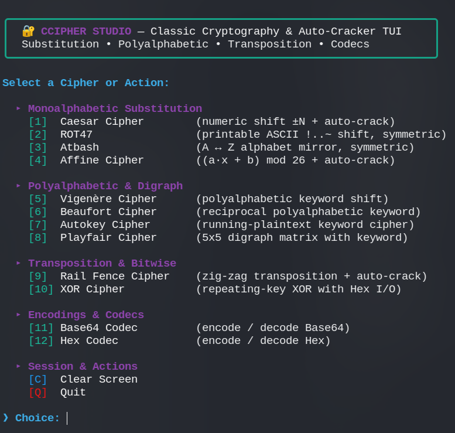

# 🔐 ccipher — Classic Cryptography & Auto-Cracker Studio

**ccipher** is a zero-dependency Rust CLI tool, Unix pipe filter, and interactive TUI studio for classic cryptographic algorithms, encodings, frequency analysis, and automated cryptanalysis.



---

## ✨ Features

- **12 Classic Ciphers & Codecs** organized into four cryptographic categories
- **Interactive TUI Studio** with session history, output chaining (`Reuse last output`), and file I/O
- **Automated Cryptanalysis (`--brute-force` / `-b`)** for Caesar, Affine (all 311 valid keys), and Rail Fence using English $\chi^2$ letter frequency and bigram scoring
- **Visual Letter Frequency Histogram (`--freq` / `-f`)** comparing observed A–Z distribution against expected English frequencies
- **Encoding Layer Chaining (`--base64`, `--hex`)** to automatically wrap encrypted output or pre-decode before decrypting/cracking
- **Unix Pipe & Constant-Memory Streaming** support (`cat file.txt | ccipher -s 3`)
- **Zero External Dependencies** — written in 100% pure standard library Rust

---

## 🧩 Supported Algorithms

> 📚 **Detailed Mathematical & Implementation Docs:** See the [`docs/`](docs/README.md) folder for in-depth guides on every algorithm:
> - [`docs/01-monoalphabetic-ciphers.md`](docs/01-monoalphabetic-ciphers.md) — Caesar, ROT47, Atbash & Affine
> - [`docs/02-polyalphabetic-and-digraph-ciphers.md`](docs/02-polyalphabetic-and-digraph-ciphers.md) — Vigenère, Beaufort, Autokey & Playfair
> - [`docs/03-transposition-and-bitwise-ciphers.md`](docs/03-transposition-and-bitwise-ciphers.md) — Rail Fence & Repeating-Key XOR
> - [`docs/04-encodings-and-codecs.md`](docs/04-encodings-and-codecs.md) — Base64, Hex & Encoding Layer Chaining
> - [`docs/05-cryptanalysis-and-auto-cracking.md`](docs/05-cryptanalysis-and-auto-cracking.md) — $\chi^2$ Frequency Analysis, Bigram Scoring & Auto-Crackers

### ▸ Monoalphabetic Substitution
| Cipher | CLI Name / Flag | Description | Auto-Crack |
| :--- | :--- | :--- | :---: |
| **Caesar Cipher** | `-c caesar -s <N>` | Shifts ASCII letters by $\pm N \pmod{26}$ | ✅ |
| **ROT47** | `-c rot47` / `--rot47` | Shifts printable ASCII (`!` to `~`, 33–126) by 47 (symmetric) | — |
| **Atbash** | `-c atbash` / `--atbash` | Mirrors the alphabet (`A ↔ Z`, `a ↔ z`, symmetric) | — |
| **Affine Cipher** | `--affine <A,B>` | Linear substitution $E(x) = (ax + b) \bmod 26$ with $\gcd(a, 26) = 1$ | ✅ |

### ▸ Polyalphabetic & Digraph
| Cipher | CLI Name / Flag | Description |
| :--- | :--- | :--- |
| **Vigenère Cipher** | `-c vigenere -k <KEY>` | Polyalphabetic shift using a repeating keyword |
| **Beaufort Cipher** | `-c beaufort -k <KEY>` | Reciprocal symmetric polyalphabetic cipher $C = (K - P) \bmod 26$ |
| **Autokey Cipher** | `-c autokey -k <KEY>` | Polyalphabetic cipher using keyword followed by running plaintext |
| **Playfair Cipher** | `-c playfair -k <KEY>` | $5\times 5$ digraph matrix substitution (`I`/`J` merged) |

### ▸ Transposition & Bitwise
| Cipher | CLI Name / Flag | Description | Auto-Crack |
| :--- | :--- | :--- | :---: |
| **Rail Fence Cipher** | `-c rail-fence -r <N>` | Zig-zag transposition across $N$ rails | ✅ |
| **XOR Cipher** | `-c xor -k <KEY>` | Repeating-key bitwise XOR with lowercase Hex output/input | — |

### ▸ Encodings & Codecs
| Codec | CLI Name / Flag | Description |
| :--- | :--- | :--- |
| **Base64** | `-c base64` / `--base64` | Standard RFC 4648 Base64 encoder & decoder |
| **Hex** | `-c hex` / `--hex` | Hexadecimal string encoder & decoder |

---

## 🚀 Installation & Build

```bash
git clone https://github.com/yagiz/ccipher.git
cd ccipher
cargo build --release
```

Run tests:

```bash
cargo test
```

---

## 💻 Usage

### 1. Interactive TUI Studio
Run `ccipher` without arguments to launch the interactive TUI menu:

```bash
cargo run
# or
./target/release/ccipher
```

### 2. Command-Line Examples

**Caesar Encrypt & Decrypt:**
```bash
ccipher -s 3 "Attack at dawn!"
ccipher -d -s 3 "Dwwdfn dw gdzq!"
```

**Auto-Crack Caesar / Affine / Rail Fence with Frequency Chart:**
```bash
ccipher -b "Wkh txlfn eurzq ira mxpsv ryhu wkh odcb grj." -f
ccipher -c affine -b "Ihhwvc Swfrcp"
ccipher -c rail-fence -b "WECRLTEERDSOEEFEAOCAIVDEN"
```

**Vigenère, Beaufort, Autokey & Playfair:**
```bash
ccipher -c vigenere -k LEMON "Attack at dawn!"
ccipher -c beaufort -k FORTIFICATION "Defend the east wall"
ccipher -c autokey -k QUEENLY "Defend the east wall"
ccipher -c playfair -k "PLAYFAIR EXAMPLE" "HIDE THE GOLD"
```

**Chaining Ciphers with Base64 or Hex Layers:**
```bash
# Encrypt with Vigenère and wrap output in Base64
ccipher -c vigenere -k SECRET --base64 "Classified message"

# Decode Base64 first, then decrypt Vigenère
ccipher -d -c vigenere -k SECRET --base64 "V214..."
```

**Unix Pipes & File I/O:**
```bash
echo "Secret payload" | ccipher --rot47
ccipher -c xor -k MYKEY -i plain.txt -o cipher.hex
```

---

## 📋 CLI Reference

```text
Usage:
  ccipher                        Launch interactive TUI studio
  ccipher [OPTIONS] [TEXT]       Run CLI operation
  cat file.txt | ccipher [OPTS]  Stream via Unix stdin/stdout pipes

Operations & Keys:
  -e, --encrypt            Encrypt / encode mode (default)
  -d, --decrypt            Decrypt / decode mode
  -b, --brute-force        Auto-crack mode (Caesar, Affine, Rail Fence)
  -s, --shift <NUM>        Caesar shift key (integer, e.g. 3)
  -r, --rails <NUM>        Rail Fence rail count (e.g. 3)
  -k, --key <KEYWORD>      Keyword for Vigenère, Beaufort, Autokey, Playfair, or XOR
      --affine <A,B>       Affine cipher keys, e.g. --affine 5,8

Encoding Chaining & Analysis:
      --base64             Wrap output in Base64 (or run Base64 if no cipher set)
      --hex                Wrap output in Hex (or run Hex if no cipher set)
  -f, --freq               Display visual letter frequency histogram (A-Z vs English)
  -q, --raw                Emit raw output only (auto-enabled when stdout is piped)

File I/O:
  -i, --input <FILE>       Read input text from file
  -o, --output <FILE>      Write result to file
  -h, --help               Show help message
```

---

## 📄 License

Licensed under the [GNU General Public License v3.0](LICENSE).
