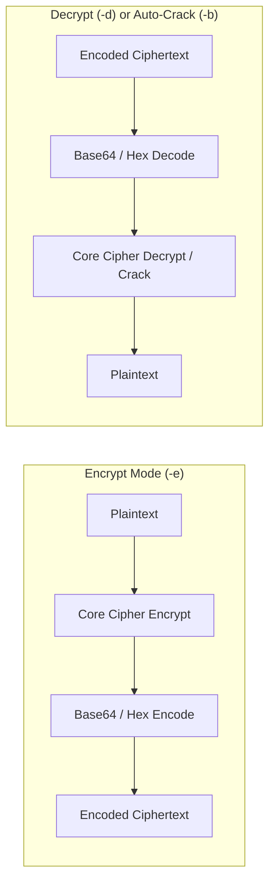

# 📦 Encodings, Codecs & Layer Chaining

While ciphers use a secret key to conceal the meaning of a message, **encodings (codecs)** are public, keyless reversible transformations designed to represent arbitrary binary data safely across text-only transports.

In **ccipher**, two zero-dependency codecs are implemented in [`src/ciphers.rs`](../src/ciphers.rs), and can be used either as **standalone algorithms** (`-c base64`, `-c hex`) or as **chaining layers** (`--base64`, `--hex`) around any cipher:
1. [Base64 Codec (RFC 4648)](#1-base64-codec-rfc-4648)
2. [Hexadecimal (Base-16) Codec](#2-hexadecimal-base-16-codec)
3. [Encoding Layer Chaining Architecture](#3-encoding-layer-chaining-architecture)

---

## 1. Base64 Codec (RFC 4648)

### Conceptual Overview
**Base64** encodes arbitrary byte streams into a 64-character ASCII alphabet (`A–Z`, `a–z`, `0–9`, `+`, `/`) with `=` used for tail padding. It works by grouping every **3 input bytes** ($3 \times 8 = 24$ bits) into **4 6-bit indices** ($4 \times 6 = 24$ bits), where each 6-bit value ($0..=63$) indexes into the RFC 4648 lookup table:

| Index Range | Characters |
| :--- | :--- |
| `0..=25` | `'A'..='Z'` |
| `26..=51` | `'a'..='z'` |
| `52..=61` | `'0'..='9'` |
| `62`, `63` | `'+'`, `'/'` |
| Padding | `'='` |

### Bitwise Algorithm (`base64_encode` & `base64_decode`)

#### Encoding (`src/ciphers.rs:586-611`)
For each 3-byte chunk $(b_0, b_1, b_2)$:
1. Pack the bytes into a 24-bit integer `triple`:
   $$\text{triple} = (b_0 \ll 16) \;\mid\; (b_1 \ll 8) \;\mid\; b_2$$
2. Extract four 6-bit groups using right shifts and the bitmask `0x3F` ($63 = \mathtt{111111_2}$):
   - $c_0 = \text{B64\_TABLE}[(\text{triple} \gg 18) \ \& \ \mathtt{0x3F}]$
   - $c_1 = \text{B64\_TABLE}[(\text{triple} \gg 12) \ \& \ \mathtt{0x3F}]$
   - $c_2 = \text{B64\_TABLE}[(\text{triple} \gg 6) \ \& \ \mathtt{0x3F}]$ (or `'='` if chunk has only 1 byte)
   - $c_3 = \text{B64\_TABLE}[\text{triple} \ \& \ \mathtt{0x3F}]$ (or `'='` if chunk has $\le 2$ bytes)

```text
Input Bytes (3 x 8 bits):   [  01001101  ] [  01100001  ] [  01101110  ]   ('M', 'a', 'n')
24-bit Bitstream:            010011 010110 000101 101110
6-bit Indices (4 x 6 bits): [  19  |  22  |   5  |  46  ]
Base64 Output Characters:     'T'    'W'    'F'    'u'                     ("TWFu")
```

#### Decoding (`src/ciphers.rs:613-652`)
1. Strip all ASCII whitespace (`filter(|b| !b.is_ascii_whitespace())`) so multi-line Base64 blocks decode seamlessly.
2. Validate that the cleaned length is a multiple of 4 (`clean.len() % 4 == 0`).
3. For each 4-character chunk $(v_0, v_1, v_2, v_3)$, reconstruct the 24-bit integer:
   $$\text{triple} = (v_0 \ll 18) \;\mid\; (v_1 \ll 12) \;\mid\; (v_2 \ll 6) \;\mid\; v_3$$
4. Extract up to 3 bytes (skipping bytes corresponding to `'='` padding):
   - Byte 0: $(\text{triple} \gg 16) \ \& \ \mathtt{0xFF}$
   - Byte 1 (if `chunk[2] != b'='`): $(\text{triple} \gg 8) \ \& \ \mathtt{0xFF}$
   - Byte 2 (if `chunk[3] != b'='`): $\text{triple} \ \& \ \mathtt{0xFF}$

---

## 2. Hexadecimal (Base-16) Codec

### Conceptual Overview
**Hexadecimal encoding** represents each 8-bit byte ($0..=255$) as two base-16 digits (`0–9`, `a–f`), where the first digit encodes the high nibble ($b \gg 4$) and the second digit encodes the low nibble ($b \ \& \ \mathtt{0x0F}$).

### Implementation Details (`src/ciphers.rs:553-582`)
- **Encoding (`hex_encode_bytes` / `hex_encode`):**
  Pre-allocates `bytes.len() * 2` characters and formats each byte as two lowercase hex digits via `format!("{b:02x}")`.
- **Decoding (`hex_decode_bytes` / `hex_decode`):**
  1. Filters out all whitespace characters (allowing space-separated or multi-line hex dumps like `"48 65 6c 6c 6f"`).
  2. Verifies an even digit count (`clean.len() % 2 == 0`).
  3. Parses each 2-character slice using `u8::from_str_radix(&clean[i..i + 2], 16)` (accepting both uppercase `A-F` and lowercase `a-f`).

---

## 3. Encoding Layer Chaining Architecture

In addition to running Base64 or Hex standalone, **ccipher** supports **automatic encoding layer chaining** via `apply_encoding_layer` in [`src/tui.rs`](../src/tui.rs#L120-L144).

When `--base64` or `--hex` is combined with any cipher (e.g., Vigenère, Caesar, Affine, Playfair):



### CLI Chaining Examples
```bash
# 1. Encrypt with Vigenère (key=SECRET) and wrap output in Base64
ccipher -c vigenere -k SECRET --base64 "Classified message"
# Output: V214a2Iy...

# 2. Decode Base64 first, then decrypt Vigenère
ccipher -d -c vigenere -k SECRET --base64 "V214a2Iy..."

# 3. Pre-decode Hex and auto-crack Caesar cipher
ccipher -b --hex "4b686f6f722c205a72756f6721"
```
